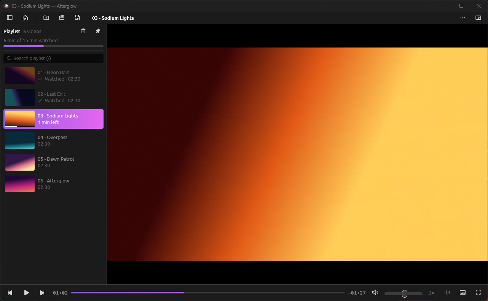
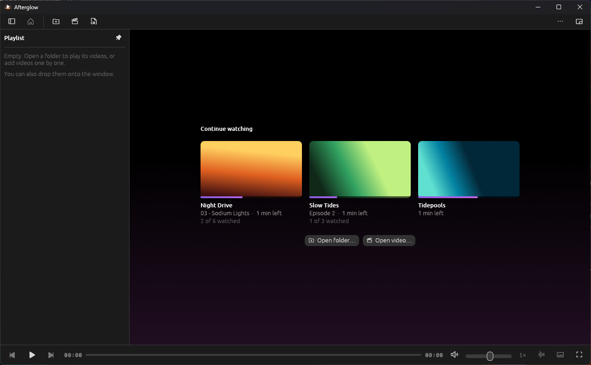

<p align="center"></p>

<h1 align="center">Afterglow</h1>

<p align="center">
An open-source, experimental video player, made for my own use.<br>
Based on mpv and built in Rust.
</p>



Afterglow is a video player for Windows that remembers where you left off. Open the folder of
a show and it plays the episodes in order, picking up where you stopped. Open a single video,
like a movie, and it plays just that.

It's a personal project: I build what I want in a player, the way I want it. You're welcome to
use it, but expect rough edges, and features that come and go.

## Download

Get the setup (`afterglow-…-setup.exe`) from the
[latest release](https://github.com/masterluma64/afterglow/releases/latest). It needs 64-bit
Windows 10 or 11, installs just for you (no administrator rights needed) and adds Afterglow to
"Open with" for videos. Running a newer setup updates it; uninstall it from Settings › Apps.
Rather not install? The `.7z` has the bare `afterglow.exe`, which runs from anywhere.

Afterglow isn't code-signed, so Windows SmartScreen may warn you the first time. Choose
**More info**, then **Run anyway**.

## What it does



- **Picks up where you left off.** Every video remembers its position, and counts as watched
  once you're 90% in (adjustable). The home screen shows what you're in the middle of, with a
  still of what's next; one click carries on.
- **Plays a show in order.** Open a folder and its episodes become the playlist, each with a
  still and how much is left. The next one starts after a short countdown. New episodes
  added to the folder show up by themselves.
- **Skips openings and endings,** found from chapter names or set once for a whole show.
- **Gets subtitles and sound in sync.** Shift the subtitles, sync them to the line you just
  heard, or fix ones made for another frame rate. Delay or advance the sound for audio that's
  out of sync (G / H). Your choices are remembered per video, or per show.
- **Stays out of the way.** A mini player kept on top in a corner of the screen (Shift+T),
  fullscreen with controls that hide, and media keys and taskbar controls that work while
  you're in another window.
- **Keeps stats:** time watched, streaks, the last 30 days and your most watched shows, which
  you can name.
- **Takes screenshots** (C), with subtitles, to the clipboard and `Pictures\Afterglow`.
- **Has a key for everything.** Press `?` for the list, or Ctrl+K to find any command.

| Key | Action |
| --- | --- |
| Space | Play / pause |
| ← / → | Seek 5 s (Shift: 30 s) |
| ↑ / ↓ | Volume |
| N / P | Next / previous video |
| Enter | Skip the opening or ending |
| W | Mark watched / unwatched |
| O / Shift+O | Open a folder / a single video |
| F | Fullscreen |
| Shift+T | Mini player |
| Ctrl+K | Find any command |

## Your data

Progress, settings and stats stay on your PC, in `%LOCALAPPDATA%\afterglow`. Afterglow
doesn't collect or send anything, and only goes online when you click a link in it.
Uninstalling leaves that folder, so your progress is still there if you reinstall; delete it
to remove everything.

## How it's made

Afterglow is written in Rust, with [egui](https://github.com/emilk/egui) for the interface and
[libmpv](https://mpv.io) (with FFmpeg) for playing video, sound and subtitles.

**AI disclosure:** much of Afterglow's code and documentation was written with AI assistance,
by Anthropic's Claude through Claude Code. I decide what goes in, direct the work, and test
and review the changes before they're released.

## Building

Put `libmpv-2.dll` from shinchiro's
[mpv-winbuild-cmake](https://github.com/shinchiro/mpv-winbuild-cmake/releases) (the
`mpv-dev-x86_64` archive) in `vendor/`. Release builds only accept the DLL whose SHA-256 is in
`vendor/libmpv-2.dll.sha256` (release 20261016); to update libmpv, test the new one and put its
hash there.

```sh
cargo run --release
cargo run --release -- "D:\Shows\Foo"    # play a folder
```

The release exe has libmpv packed in, and unpacks it into the data folder on its first start.
`AFTERGLOW_DATA_DIR` sets another data folder, for testing. `docs/releasing.md` describes
making a release, including the setup.

## License

Afterglow is free software: you can redistribute it and/or modify it under the terms of the
GNU General Public License as published by the Free Software Foundation, either version 3 of
the License, or (at your option) any later version. See [`LICENSE`](LICENSE).

Release builds include libmpv and FFmpeg (GPL) from shinchiro's
[mpv-winbuild-cmake](https://github.com/shinchiro/mpv-winbuild-cmake). Icons are
[Phosphor](https://phosphoricons.com) (MIT); bold text is Ubuntu Medium (Ubuntu Font Licence).
[`THIRD-PARTY-NOTICES.txt`](THIRD-PARTY-NOTICES.txt) lists everything Afterglow is built with.
